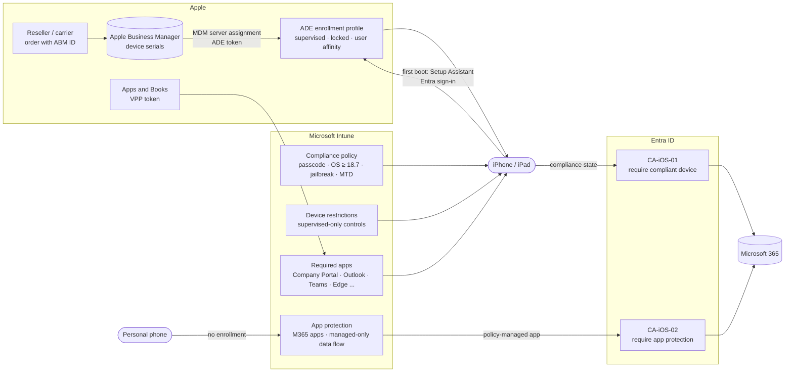
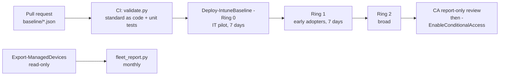

# Intune iOS / iPadOS Fleet Baseline

**A corporate iPhone and iPad fleet managed end to end: purchased into Apple Business Manager, enrolled zero-touch
through Automated Device Enrollment, supervised and locked to management, held to a compliance baseline that Conditional
Access enforces, with Microsoft 365 data protected by app protection policies. The baseline is defined as JSON, checked
against a written security standard in CI, deployed in rings with PowerShell and Microsoft Graph, and reported on monthly.**

> **Provenance.** This is a portfolio reference implementation of the iOS fleet standard I built and manage as a Senior Systems
> Specialist (Apple Business Manager, Intune, compliance and app protection for a corporate iOS fleet). **It contains no
> employer configuration, device data, serial numbers or names.** The fleet data in `data/synthetic/` is generated from a seed
> (`tools/generate_fleet.py`), and all users are `@contoso.example`.

## Architecture



## What is in the baseline

| Object | File | Key settings |
|---|---|---|
| Compliance | `baseline/compliance-ios.json` | 6-digit passcode, simple codes blocked, auto-lock 5 min, **iOS ≥ 18.7** (N-1 latest), jailbreak = non-compliant, mobile threat defense ≤ medium, non-compliant after 24 h |
| Device restrictions | `baseline/restrictions-ios.json` | No iCloud backup or document sync for managed data, managed → unmanaged open-in blocked, no untrusted enterprise apps, profiles locked, no host pairing, wipe after 10 failed passcodes |
| App protection | `baseline/app-protection-ios.json` | 10 Microsoft 365 apps; data only to managed apps; paste in only; no backup or Save As to personal storage; app PIN; Edge for links; wipe app data after 90 days offline |
| ADE enrollment | `baseline/enrollment-ade.json` | Supervised, mandatory, non-removable, user authentication in Setup Assistant, restore from personal backup blocked, consumer screens skipped |
| Conditional Access | `baseline/conditional-access.json` | Corporate users: compliant device. Everyone on iOS: app protection. Break-glass excluded. Report-only first |
| Rings and groups | `baseline/assignments.json` | Ring 0 IT pilot → Ring 1 early adopters → Ring 2 broad; dynamic group on the ADE profile name |

The written standard behind these values: [docs/security-standard.md](docs/security-standard.md).

## Pipeline



## Quick start

```bash
python3 tools/validate.py                         # standard as code
python3 -m unittest discover -s tests -v          # 12 tests
python3 tools/fleet_report.py --data data/synthetic --out out
```

```text
400 devices, 84.5% compliant; below_min_os 48, stale 35, not_supervised 7, not_ade 6, abm_unassigned 11,
abm_not_enrolled 9, intune_not_in_abm 0, jailbroken 2, refresh_candidates 103. Report: out/fleet_report.md
```

Deploying (test tenant first):

```powershell
Connect-MgGraph -Scopes DeviceManagementConfiguration.ReadWrite.All,DeviceManagementApps.ReadWrite.All,`
    Policy.ReadWrite.ConditionalAccess,Policy.Read.All,Group.Read.All
./scripts/Deploy-IntuneBaseline.ps1 -Ring 0 -WhatIf
./scripts/Deploy-IntuneBaseline.ps1 -Ring 0
```

The validator, report and tests run locally and in CI. The PowerShell deploy and export scripts call live Graph
endpoints. CI checks their syntax and runs PSScriptAnalyzer, but they have not been run against a tenant from this repository.

## Documentation

| Document | Contents |
|---|---|
| [Security standard](docs/security-standard.md) | The written requirements the baseline and validator implement, with reasons |
| [Architecture](docs/architecture.md) | Components, trust flow, design decisions, corporate vs BYOD |
| [Device lifecycle](docs/enrollment-lifecycle.md) | Procure → ABM → ADE → use → repair/replace → retire, with who does what |
| [Rollout plan](docs/rollout.md) | Rings, entry/exit criteria, Conditional Access cut-over, rollback |
| [Operations runbook](docs/runbook.md) | New starter, lost/stolen device, leaver, OS update, ABM token renewal |
| [Fleet reporting](docs/reporting.md) | Monthly report: each finding, its threshold and the action |

## Skills shown

Microsoft Intune · Apple Business Manager · Automated Device Enrollment · supervised iOS · compliance policies · app protection (MAM) · Conditional Access · Microsoft Graph · PowerShell · Python · configuration as code · ring-based change management · fleet reporting
