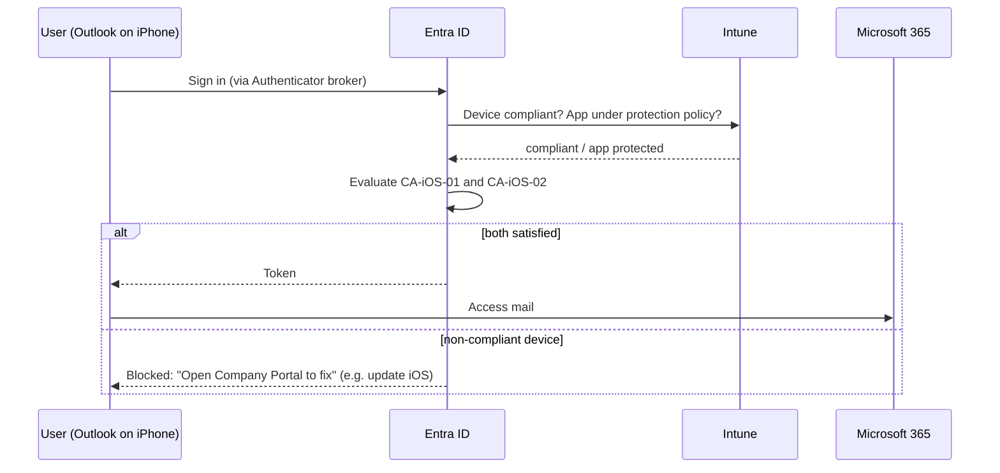

# Architecture

## Components

| Component | Role | Owner |
|---|---|---|
| Apple Business Manager (ABM) | Source of truth for every corporate device serial; assigns devices to the Intune MDM server | IT asset management |
| Reseller / carrier | Adds devices to ABM at purchase using the organisation's ABM customer number | Procurement |
| ADE token (ABM ↔ Intune) | Lets Intune push the enrollment profile to devices on first boot. Renewed every year | Endpoint team |
| Apps and Books (VPP) token | Device-licensed apps, installed silently with no Apple ID | Endpoint team |
| Apple MDM push certificate | Required for every Apple MDM command. Renewed every year **with the same Apple ID** | Endpoint team |
| Intune | Enrollment profile, compliance, configuration, apps, app protection, remote actions | Endpoint team |
| Entra ID | Identity, dynamic groups, Conditional Access | Identity team |
| Mobile threat defense | Device risk signal to Intune compliance | Security |

## Corporate vs personal devices

| | Corporate (ADE, supervised) | Personal (BYOD) |
|---|---|---|
| Enrollment | Automated, mandatory | None |
| Intune sees | Whole device (inventory, OS, compliance) | Only the managed apps |
| Controls | Compliance + restrictions + app protection | App protection only |
| CA requirement | Compliant device + approved app | Approved app with app protection |
| IT can wipe | Whole device | Corporate data in managed apps only (selective wipe) |

App protection applies to both, so Microsoft 365 data is protected the same way whoever owns the device. Device-level
controls are applied only where the organisation owns the device.

## Trust flow at sign-in

## Design decisions

| Decision | Alternative | Reason |
|---|---|---|
| Supervised ADE for every corporate device | User-initiated enrollment via Company Portal | Management cannot be removed; stronger controls; zero-touch for the user |
| User affinity, Setup Assistant authentication | Userless devices | Compliance and CA are per user; shared devices are a separate profile |
| N-1 latest as the OS floor | Latest only | Latest-only blocks too many users on release day; N-1 latest is still patched |
| Software updates through Declarative Device Management | Legacy update policies | DDM enforces a deadline on the device and reports status reliably |
| App protection on corporate devices too | Device controls only | Covers data flows that device restrictions can't see (copy/paste, Save As between apps) |
| CA in report-only first | Enable immediately | Sign-in logs show exactly who would be blocked before anyone is |
| Dynamic group on the enrollment profile name | Assigned device groups | New devices get the baseline automatically; nobody maintains lists |
| JSON + validator + PowerShell | Portal only | Peer review, history and an automatic check against the standard |

## Single points of failure (and mitigations)

| Item | If it lapses | Mitigation |
|---|---|---|
| Apple MDM push certificate | **Every** iOS device must re-enroll | Calendar reminders at 30/14/7 days; shared Managed Apple ID, not a personal one |
| ADE token | New devices stop enrolling | Reminders; renewal in the runbook |
| VPP token | App installs and updates stop | Reminders; renewal in the runbook |
