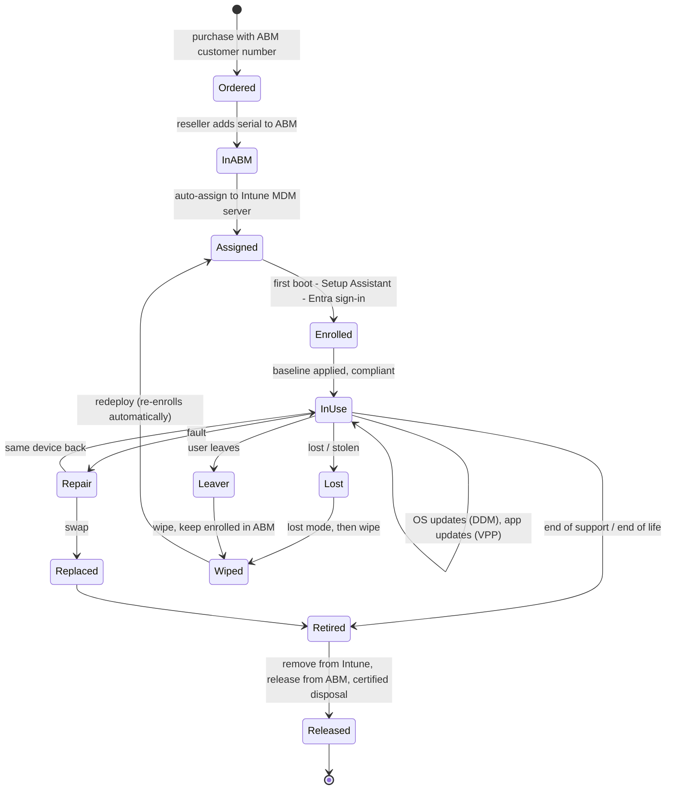

# Device Lifecycle

## Stages

| Stage | Steps | Who | Evidence |
|---|---|---|---|
| **Procure** | Order only from resellers or carriers linked to ABM; quote the ABM customer number | Procurement | PO with ABM ID |
| **ABM** | Serial appears in ABM; default MDM server assignment set to Intune for iPhone and iPad | Asset management | ABM device list |
| **Enroll** | User powers on, joins Wi-Fi, signs in with work account; profile installs; apps install | User (zero-touch) | Intune enrollment record |
| **Use** | Monthly report; OS updates via DDM with a deadline; compliance enforced by CA | Endpoint team | Fleet report |
| **Repair / replace** | Apple or the reseller repairs; replacements arrive in ABM like new devices | Service desk | Ticket |
| **Lost / stolen** | Lost mode with message, locate, then wipe if not recovered within 24 h; Activation Lock stays (supervised, managed bypass code kept in Intune) | Service desk + security | Ticket, Intune action log |
| **Leaver** | Wipe from Intune; device stays in ABM and re-enrolls for the next user | Service desk | Leaver ticket |
| **Retire** | Wipe, delete from Intune, **release from ABM**, certified recycling | Asset management | Disposal certificate |

Releasing from ABM is irreversible, so do it only for devices that are leaving the organisation.

## Devices bought outside the reseller channel

Add them to ABM with **Apple Configurator for iPhone**. They then have a 30-day provisional period in which the user can remove
them from management. Use this channel only as an exception, and record it in the ticket.
